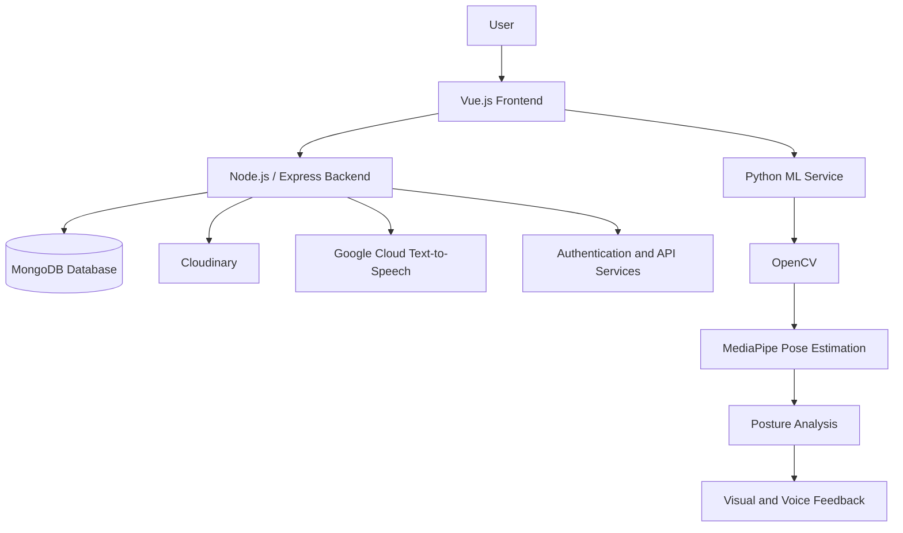

# 🧘 YogaVerse – Your Complete Yoga & Wellness Community Platform

<p align="center">
  <strong>Practice Yoga. Build Connections. Find Your Balance.</strong>
</p>

YogaVerse is a full-stack yoga and wellness platform that brings together yoga enthusiasts, trainers, and communities in one place. It combines modern web technologies with AI-powered computer vision to make yoga practice more interactive, accessible, and engaging.

Built as a hackathon project, YogaVerse aims to bridge the gap between traditional yoga practice and modern technology by providing a platform for learning yoga, discovering trainers, participating in events, connecting with communities, and exploring AI-assisted yoga practice.

---

## 📌 Table of Contents

- [About the Project](#-about-the-project)
- [Problem Statement](#-problem-statement)
- [Our Solution](#-our-solution)
- [Key Features](#-key-features)
- [AI-Powered Yoga Practice](#-ai-powered-yoga-practice)
- [Technology Stack](#-technology-stack)
- [System Architecture](#-system-architecture)
- [Project Structure](#-project-structure)
- [Getting Started](#-getting-started)
- [Environment Configuration](#-environment-configuration)
- [Application Workflow](#-application-workflow)
- [Future Enhancements](#-future-enhancements)
- [Contributors](#-contributors)

---

## 🌟 About the Project

YogaVerse is designed to create a connected digital ecosystem for people interested in yoga and wellness.

The platform provides multiple functionalities, including:

- Learning about different yoga asanas.
- Exploring yoga trainers.
- Discovering yoga events.
- Connecting with nearby yoga communities.
- Sharing experiences and interacting with other practitioners.
- Practicing yoga with AI-assisted posture feedback.

The project integrates frontend development, backend services, database management, authentication, cloud services, and computer vision into one application.

## ❗ Problem Statement

Traditional yoga practice often comes with several challenges:

- Beginners may struggle to perform yoga postures correctly.
- Finding qualified yoga trainers can be difficult.
- People interested in yoga may lack a community to practice with.
- Discovering nearby yoga events and activities is not always convenient.
- Access to personalized posture guidance may require a professional instructor.

## 💡 Our Solution

YogaVerse addresses these challenges through a unified digital platform.

By combining full-stack web development with computer vision, the platform provides users with an environment where they can learn, practice, interact, and participate in yoga-related activities.

Our goal is to make yoga more accessible while encouraging community engagement and technology-assisted learning.

---

## ✨ Key Features

### 1. 👤 User Authentication & Profile Management

- User registration and login.
- JWT-based authentication.
- Access and refresh token management.
- Google OAuth integration.
- User profile management.
- Personalized user preferences.

### 2. 🧘 Yoga Asana Library

- Explore different yoga asanas.
- View detailed information about yoga postures.
- Learn Sanskrit meanings and origins.
- Explore historical backgrounds and benefits.
- Discover yoga poses through categorized listings.
- Asana of the Day functionality.
- Audio narration using Google Cloud Text-to-Speech.

### 3. 🤖 AI-Powered Yoga Practice

- Camera-based human pose detection.
- Body landmark detection using MediaPipe.
- Posture analysis using joint angles and distances.
- Real-time visual feedback.
- Voice-based instructions using text-to-speech.
- Step-by-step assistance for yoga practice.

### 4. 🧑‍🏫 Yoga Trainer Discovery

- Explore available yoga trainers.
- View trainer information.
- Access trainer details.
- Backend support for trainer creation, updating, and deletion.

### 5. 📅 Yoga Events

- Discover yoga-related events.
- Explore events based on user locations and interests.
- View event information.
- Access event-related details.
- Support for event notifications through email scheduling.

### 6. 👥 Yoga Communities

- Discover suggested yoga communities.
- Find communities based on location and interests.
- Join and leave communities.
- Interact with community members.
- Create and share community posts.
- Delete posts.

### 7. ☁️ Cloud-Based Image Uploads

- Image upload functionality using Multer.
- Cloudinary integration for storing community post images.
- Support for JPG, JPEG, and PNG image formats.

---

## 🤖 AI-Powered Yoga Practice

One of the important components of YogaVerse is its computer vision-based yoga practice module.

It uses Python and MediaPipe to identify human body landmarks and analyze posture.

### How It Works

1. The webcam captures the user's movements.
2. OpenCV processes the camera frames.
3. MediaPipe identifies body landmarks.
4. Joint angles and distances are calculated.
5. The application evaluates posture conditions.
6. Feedback is provided through visual messages and voice instructions.

### Technologies Used

- Python
- OpenCV
- MediaPipe
- Flask
- pyttsx3
- Multithreading

### Current Pose Detection Implementation

The included Python implementation contains a step-by-step Tree Pose (Vrikshasana) guidance flow.

It checks:
- Arm alignment.
- Whether both arms are raised.
- Knee alignment.
- Foot placement.
- Ability to maintain the pose for a 20-second hold.

The ML service exposes endpoints for the video feed and posture feedback.

---

## 🛠️ Technology Stack

| Layer | Technologies |
|---|---|
| Frontend | Vue.js 3 |
| Build Tool | Vite |
| Styling | Tailwind CSS |
| State Management | Pinia |
| Routing | Vue Router |
| HTTP Client | Axios |
| Backend | Node.js, Express.js |
| Database | MongoDB |
| ODM | Mongoose |
| Authentication | JWT, Google OAuth 2.0 |
| Computer Vision | OpenCV |
| Pose Estimation | MediaPipe |
| ML Service | Python, Flask |
| Voice Feedback | pyttsx3 |
| Cloud Storage | Cloudinary |
| Audio Narration | Google Cloud Text-to-Speech |
| Email Services | Nodemailer |
| Version Control | Git and GitHub |

---

## 🏗️ System Architecture

YogaVerse follows a modular architecture with three primary components.



### Frontend

The frontend is responsible for:
- User interface and navigation.
- User authentication screens.
- Displaying yoga information.
- Trainer and event discovery.
- Community interaction.
- AI practice interface.

### Backend

The backend handles:
- REST API development.
- Authentication and authorization.
- Database operations.
- Community management.
- Event management.
- Trainer management.
- Image upload operations.
- Audio narration and email-related functionality.

### Machine Learning Backend

The ML component handles:
- Webcam access.
- Human pose estimation.
- Landmark extraction.
- Joint angle calculations.
- Posture validation.
- Real-time feedback generation.

---

## 📂 Project Structure

```text
Yoga-Verse/
│
├── Frontend/
│   ├── public/
│   ├── src/
│   │   ├── assets/
│   │   ├── components/
│   │   │   ├── AiPractice.vue
│   │   │   ├── AsanaDetails.vue
│   │   │   ├── Asanas.vue
│   │   │   ├── EventPage.vue
│   │   │   ├── Home.vue
│   │   │   ├── LandingPage.vue
│   │   │   ├── Login.vue
│   │   │   ├── Profile.vue
│   │   │   ├── SignUp.vue
│   │   │   ├── Trainers.vue
│   │   │   ├── communities.vue
│   │   │   └── communityView.vue
│   │   ├── router/
│   │   ├── services/
│   │   ├── stores/
│   │   ├── App.vue
│   │   └── main.js
│   │
│   ├── package.json
│   └── vite.config.js
│
├── Backend/
│   ├── controllers/
│   ├── middleware/
│   ├── models/
│   ├── oAuth/
│   ├── routes/
│   ├── utils/
│   ├── Detection/
│   ├── server.js
│   ├── notificationScheduler.js
│   └── package.json
│
├── Ml-Backend/
│   └── asanas/
│       └── tadasana.py
│
└── README.md
```

---

## ⚙️ Getting Started

Follow these instructions to set up the project locally.

### Prerequisites

Install the following:

- Node.js and npm
- Python 3
- MongoDB database
- Git
- Visual Studio Code
- Webcam for AI practice functionality

### Step 1: Clone the Repository

```bash
git clone https://github.com/sagarapumanoj/Yoga-Verse.git
```

Navigate into the project:

```bash
cd Yoga-Verse
```

### Step 2: Set Up the Frontend

```bash
cd Frontend
npm install
```

Start the frontend development server:

```bash
npm run dev
```

The frontend will be available at:

```text
http://localhost:5173
```

### Step 3: Set Up the Backend

Open another terminal:

```bash
cd Yoga-Verse/Backend
```

Install dependencies:

```bash
npm install
```

Configure the environment variables as described below.

Start the backend:

```bash
node server.js
```

The backend runs on:

```text
http://localhost:5000
```

### Step 4: Set Up the Machine Learning Backend

Open another terminal:

```bash
cd Yoga-Verse/Ml-Backend
```

Install the required Python packages:

```bash
pip install opencv-python mediapipe flask flask-cors pyttsx3
```

Start the pose detection application:

```bash
python asanas/tadasana.py
```

The Flask ML service runs on:

```text
http://localhost:5001
```

The implemented ML service exposes:

| Endpoint | Description |
|---|---|
| `/video_feed` | Live webcam feed with pose landmarks |
| `/feedback` | Current posture feedback in JSON format |

**Note:** The ML implementation requires webcam access. Allow camera permissions and ensure that no other application is exclusively using the webcam.

---

## 🔐 Environment Configuration

Create a `.env` file inside the `Backend` directory.

Configure the following variables with your own credentials:

```env
# MongoDB
MONGO_URI=your_mongodb_connection_string

# JWT Authentication
ACCESS_TOKEN_SECRET=your_access_token_secret
REFRESH_TOKEN_SECRET=your_refresh_token_secret

ACCESS_TOKEN_EXPIRES=15m
REFRESH_TOKEN_EXPIRES=7d

# Google OAuth
GOOGLE_CLIENT_ID=your_google_client_id
GOOGLE_CLIENT_SECRET=your_google_client_secret

# Cloudinary
CLOUDINARY_CLOUD_NAME=your_cloudinary_cloud_name
CLOUDINARY_API_KEY=your_cloudinary_api_key
CLOUDINARY_API_SECRET=your_cloudinary_api_secret

# Email Configuration
EMAIL_USER=your_email_address
EMAIL_PASS=your_email_app_password
```

Replace all placeholder values with valid credentials.

**Security:** Never commit your `.env` file, API keys, database credentials, or authentication secrets to GitHub.

---

## 🔄 Application Workflow

The general application workflow is:

1. Users access the YogaVerse frontend.
2. Users register or log in to the platform.
3. The frontend communicates with the backend through REST APIs.
4. The backend processes requests and interacts with MongoDB.
5. Users explore asanas, trainers, events, and communities.
6. Users can participate in community activities and share posts.
7. Users can access the AI practice interface.
8. The computer vision module processes webcam input and provides posture feedback through its ML service.

---

## 🚀 Future Enhancements

We envision expanding YogaVerse with the following features:

- Support for additional yoga poses in the ML module.
- Improved posture detection accuracy.
- Personalized AI-based yoga recommendations.
- User progress tracking and practice history.
- Personalized yoga workout plans.
- Enhanced real-time voice guidance.
- Mobile application support.
- Advanced trainer booking functionality.
- Community engagement and discussion improvements.
- Cloud deployment and scalable infrastructure.

---

## 🏆 Hackathon Project

YogaVerse was developed as part of our participation in a hackathon.

The project demonstrates our interest in combining software engineering, artificial intelligence, and computer vision to solve practical challenges in the wellness domain.

Through this project, we explored:
- Full-stack application development.
- REST API design and integration.
- Database management.
- Authentication and authorization.
- Computer vision and pose estimation.
- Team collaboration and problem-solving.

Building YogaVerse gave us an opportunity to transform an idea into a multi-component software application.

---

## 👨‍💻 Contributors

**YogaVerse Development Team**

GitHub Repository:

https://github.com/sagarapumanoj/Yoga-Verse

Developed collaboratively as a hackathon project.

---

## 📄 License

This repository does not currently specify an open-source license. Contact the project contributors for permission before redistributing or reusing the code.

---

<p align="center">
  <strong>🧘 YogaVerse – Bringing Yoga, Technology, and Community Together.</strong>
</p>
